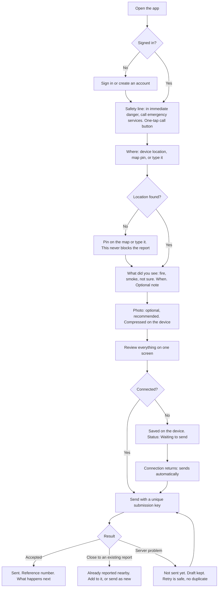
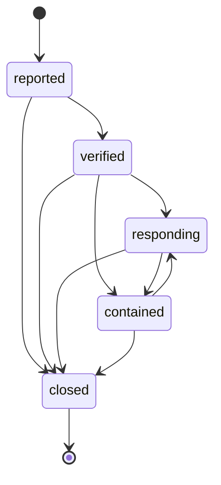
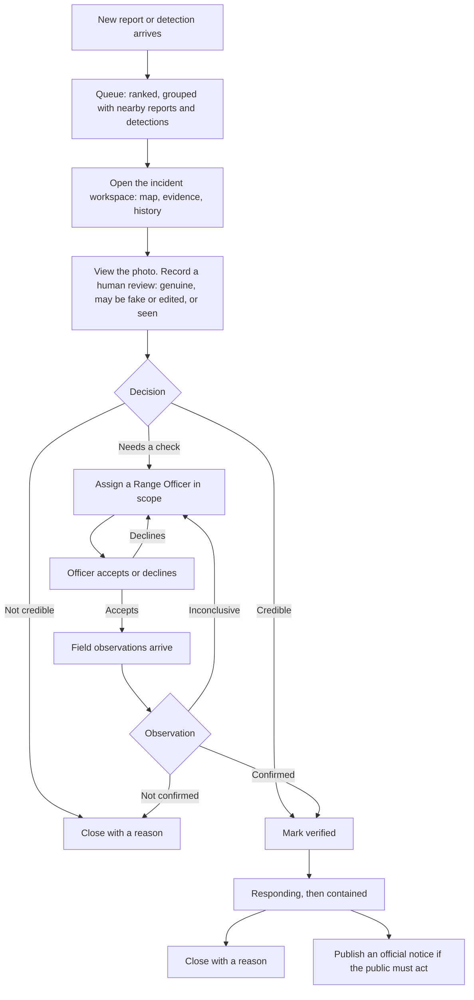
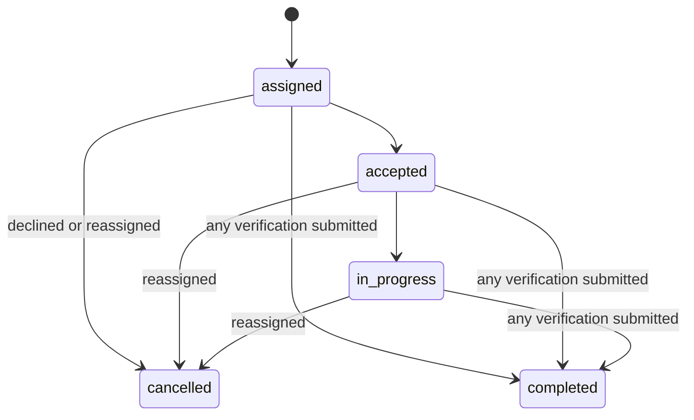
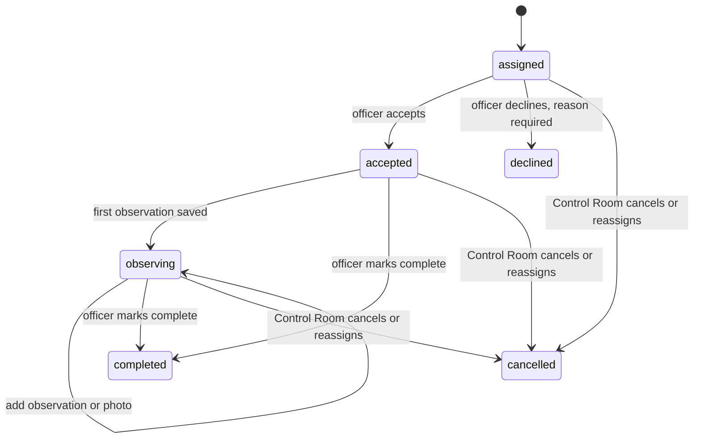
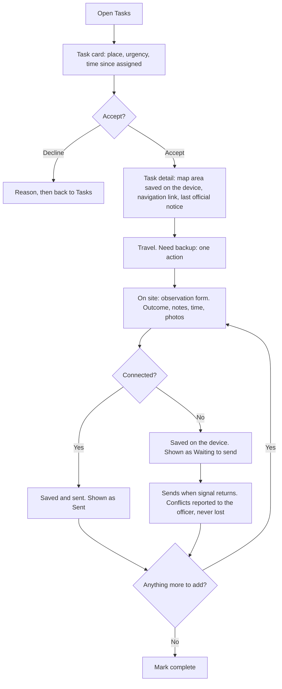
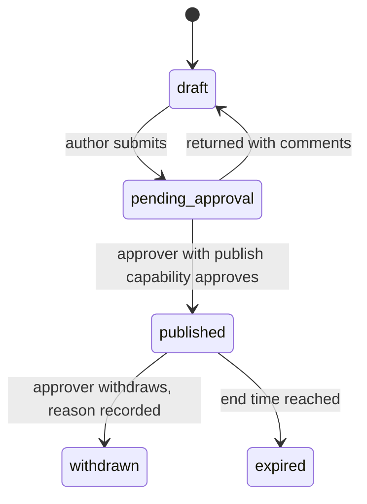
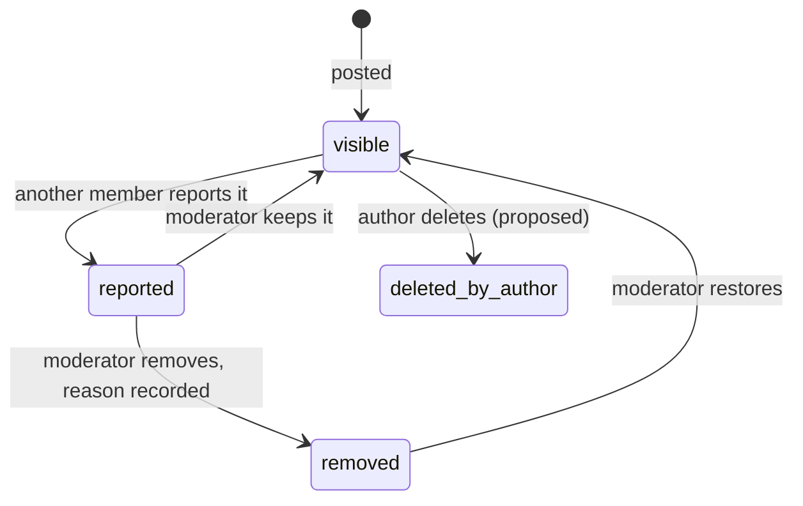
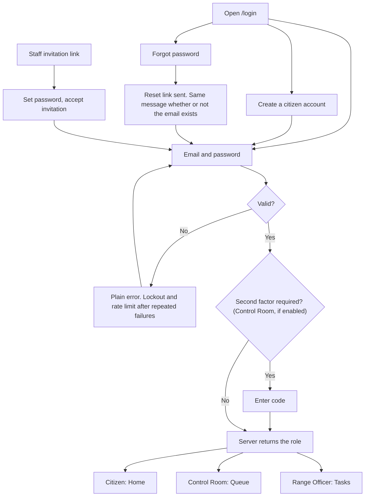

# D1: Journeys and lifecycles

Diagrams are Mermaid text (open source; they render on GitHub and in MkDocs). **Current** diagrams reflect the code at `origin/main` `2422658` [code]. **Proposed** diagrams are design decisions for review.

---
## 1. Citizen: report a fire

| Stage | Citizen goal | Failure or offline handling | Risk to design out |
|---|---|---|---|
| Safety line | Know to call first if in danger | Emergency number comes from regional configuration; never hardcoded or invented | Citizen reports instead of calling |
| Where | Give a usable location fast | GPS denied or slow: pin or type; show accuracy | Wrong location |
| What | Say what they saw | Three plain choices; note optional | Free-text burden under stress |
| Photo | Add evidence | Compress; resumable upload; photo failure never loses the report | Large uploads on weak signal |
| Send | Be sure it went | Submission key makes retries safe; visible state at all times | Duplicate reports; silent failure |
| After | Know what happened | Status timeline, notification on change | Citizen asks again or gives up |

### What the citizen sees as the status of their report
The internal status is shown in plain language. Closure needs a structured reason (new field, see findings UX-02).

| Internal status [code] | What the citizen reads |
|---|---|
| reported | Received. Forest staff will check it. |
| verified | Confirmed by forest staff. |
| responding | Teams are responding. |
| contained | Under control. |
| closed | Closed, with the reason: resolved, not a fire, or already reported. |

Citizens never see internal notes, assessment scores, reviewer names, or other people's reports.

---
## 2. Incident lifecycle (current) [code]

Rules (unchanged): only a person changes status; nothing automatic; `closed` is final. **Proposed addition**: closing requires a reason from a fixed list plus an optional note, and reopening is not allowed (a new report is linked instead).

---
## 3. Control Room: triage to close

Every arrow that changes status is a person's click with a recorded reason. The photo assessment, if enabled later, is advisory and cannot move any arrow.

---
## 4. Assignment and field verification

**Current** [code]: a verification can be submitted from `assigned`, and any verification, even "inconclusive", completes the assignment at once.

**Proposed**: accept first; allow several observations; completion is an explicit action; "need backup" is its own event.

Observation outcomes stay `confirmed`, `not_confirmed`, `inconclusive` [code]. An observation never changes the incident's status; it notifies the Control Room.

---
## 5. Range Officer: field journey (offline-first)

---
## 6. Official announcement (proposed, new feature)

Rules: the author cannot approve their own message; text written or suggested by software is only ever a draft and needs a named person's approval; publisher, approver and times are stored and shown; edits after publication create a visible revision; templates and language versions are prepared in advance.

---
## 7. Community (inside Citizen)

**Current** [code]: posts (up to 2000 characters), comments, area chat by polling, report and archive actions for staff. **No edit or delete for the author.**

Rules: Community content is always labelled "Not official information"; it is visually and structurally separate from official announcements and incident reports; chat messages carry sender and time; limits on rate and size; mute and block; moderation actions are audited. Chat transport moves from 5-second polling to server-sent events, falling back to 15-second cursor polling.

---
## 8. One login for everyone

There is no "choose your workspace" step. Staff accounts exist only by invitation.
