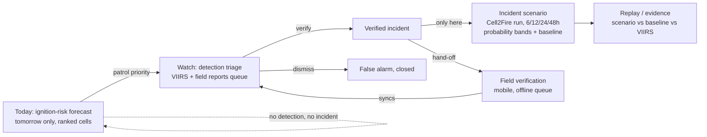

# 03. Flows

Read `02_users_and_use_cases.md` first.

## Core flow

Key rule encoded in the diagram: **Today never has an arrow into D.** A high-risk cell is a patrol priority; only a verified incident (box C) can launch a scenario.

## Per-user flow

### 1. Range officer — morning planning

1. Open Today → see today's ranked cells for their division (loading: skeleton grid; empty: "No forecast for this date — risk data is archived/demo only outside covered dates"; error: "Could not load today's ranking. Try again."; offline: last-synced ranking shown with "Showing data saved at [time]").
2. Tap a cell → see rank, band, and the plain-language "why" (top drivers), with the "tomorrow only, relative rank" badge always visible.
3. Build a short list (add cells to a patrol list).
4. Exit: share/export the list to a team (text, no app required to read it).
5. Hand-off: if a detection later appears inside one of the officer's priority cells, it surfaces back to them as a Watch notification (hand-off event: Today → Watch).

### 2. Control-room operator — detection triage

1. Open Watch → queue of detections/reports sorted by age and risk-cell overlap (loading: skeleton list; empty: "No open detections right now"; error: "Detection feed did not update — last updated [time]"; offline: not expected to operate fully offline, this is a desk role — show "Offline. Reconnect to see new detections.").
2. Open a card → see satellite/report metadata, "not yet verified" badge, map context.
3. Decide: Verify (needs evidence — photo, call confirmation, or field report already attached) / Dismiss as false alarm / Escalate to field crew for verification.
4. On Verify → becomes a Verified incident (hand-off event: Watch → Incident, and Watch → Field if sending a crew to verify first).
5. Exit: incident now visible on Incident list; operator can open the scenario only from here.

### 3. Field crew / beat guard — verification, weak signal

1. Open Field (mobile/PWA) → see assigned verification task with location (loading: cached map tiles if offline; empty: "No tasks assigned"; error: n/a — offline-first, errors are rare and shown as "Could not reach server — saved locally"; offline: full task view works from cache).
2. Navigate to location (map works offline once loaded; GPS blue dot).
3. Submit verification: photo + short note + GPS, one screen, two taps to confirm.
4. If offline: submission queues locally with "Waiting to sync" state; retried automatically on reconnect; guard can see queue depth and force-retry.
5. Exit: confirmation once synced ("Synced — control room notified"); hand-off event Field → Watch (closes the loop back to the operator's queue).

### 4. Incident commander — scenario

1. Open Incident (only reachable from a Verified incident) → Incident scenario screen.
2. See map + timeline slider (6/12/24/48h), burn-probability bands, baseline outline, wind arrows, wind-source switch, assumptions panel (loading: "Running scenario…" progress with no fake ETA claims beyond what's measured; empty: n/a, scenario always has a result once run; error: "The scenario could not run. Check the point is inside a mapped forest area." — reused from existing SpreadPage copy; offline: scenario requires connectivity, show "Scenario needs a connection — showing last result" if one exists).
3. Switch wind source → see result change, confirming the "wind dominates" rule from the narrative.
4. Compare scenario vs baseline outline at each horizon.
5. Export a briefing (image/PDF) with all labels and caveats embedded, not strippable.
6. Exit: briefing shared to crews; incident stays open until closed in Watch/Incident list.

### 5. Reviewer / judge — replay and evidence

1. Open Replay (public or linked from Incident scenario) → per-incident selector (4 incidents).
2. See simulation vs baseline (a) proximity vs baseline (b) circle vs observed VIIRS footprint at each overpass, with the real AUC/AP/IoU table (loading: static data, near-instant; empty: n/a, all 4 incidents always have full results; error: "Replay data could not load" — this is static JSON, failure should be rare and is a data/deploy issue, not a user error; offline: data can be cached since it's static and small).
3. Read the honest-conclusions summary (verbatim from `docs/RESQ5_RESULTS.md` §6, not rewritten to sound better).
4. Exit: no action required — this is an evidence/trust screen, not a workflow step.

## Hand-off events between users

| From | To | Event | What carries over |
|---|---|---|---|
| Today (officer) | Watch (operator) | A detection appears inside a priority cell the officer flagged | Cell id, officer's priority flag — surfaces as a tagged queue item, not a merged record |
| Watch (operator) | Field (guard) | Operator requests field verification before deciding | Location, detection id, any photo already attached |
| Field (guard) | Watch (operator) | Verification submitted (online or synced later) | Photo, note, GPS, timestamp, guard identity |
| Watch (operator) | Incident (commander) | Operator verifies → incident created | Verified ignition point/time, evidence trail, detection history |
| Incident (commander) | Replay (reviewer) | Any user can jump from a live scenario to the replay evidence for context | None required — it's a reference link, not a data hand-off |
